# Chapter 6 — Discussion

This chapter interprets the Results of Chapter 5. Three questions organise the discussion: (1) Do the models rely on plant structure rather than background artefacts? (2) What architectural tendencies are consistent with the measured ranking? (3) Which model should a practitioner deploy under different compute budgets?

Throughout, rankings refer to *point estimates* whose confidence intervals overlap (Chapter 5). Mechanistic statements about locality versus attention are framed as **informed hypotheses consistent with the evidence, not proven causes**.

---

## 6.1 Explainability Audit

### 6.1.1 Qualitative Saliency (Grad-CAM, SHAP, LIME)

The purpose of this audit is a **trust check**, not a headline accuracy number. We ask whether predictions rest on plant structure rather than bare soil, frame edges, or other artefacts.

**Methods used.**

- **Grad-CAM** for CNNs (requires convolutional feature maps).
- **SHAP** and **LIME** for all models, including ViT (model-agnostic).
- For ViT specifically, attention-rollout maps were near-uniform and uninformative; interpretation therefore rests on SHAP/LIME — itself a methodological finding.

**What the audit establishes (and does not).** Qualitatively, the maps are reassuring: attention concentrates on foliage for Green, and where a model struggles (Dead), heat drifts onto soil — so explanations are consistent with the accuracy results. Quantitatively, a naive “fraction of attention on vegetation” metric is uninformative on this dense-canopy dataset (§6.1.3). We report both findings openly.

**Figure 6.1 — Grad-CAM / attention on a high-biomass sample.**

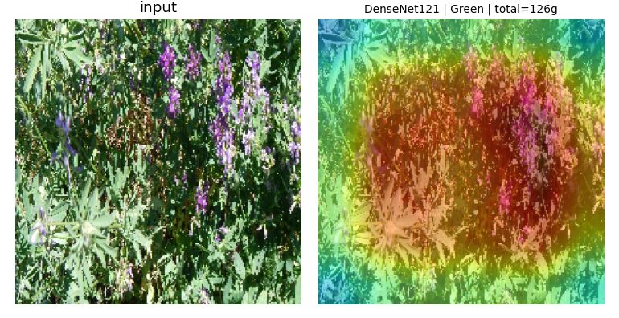

**Figure 6.1(a) — DenseNet-121 | Green.** Heat is tightly focused on central green foliage. This qualitative pattern is consistent with DenseNet’s best Green and GDM R² in Chapter 5.

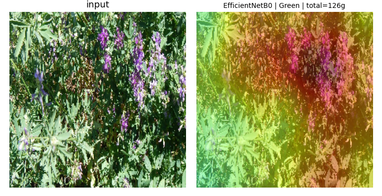

**Figure 6.1(b) — EfficientNet-B0 | Green.** Attention covers plant regions coherently, supporting biologically plausible Green reasoning for the efficiency-optimal CNN.

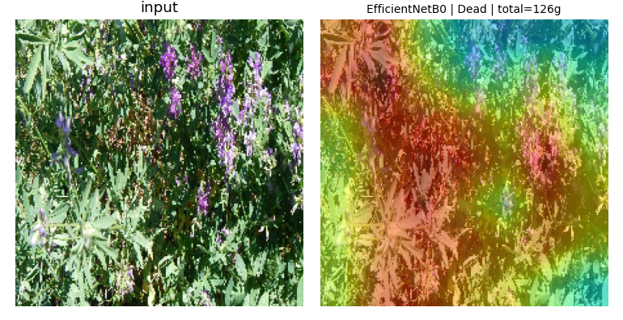

**Figure 6.1(c) — EfficientNet-B0 | Dead.** Attention is diffuse and drifts onto bare soil. This directly visualises the dead–soil spectral ambiguity that caps every model’s Dead R² at ≤ 0.33.

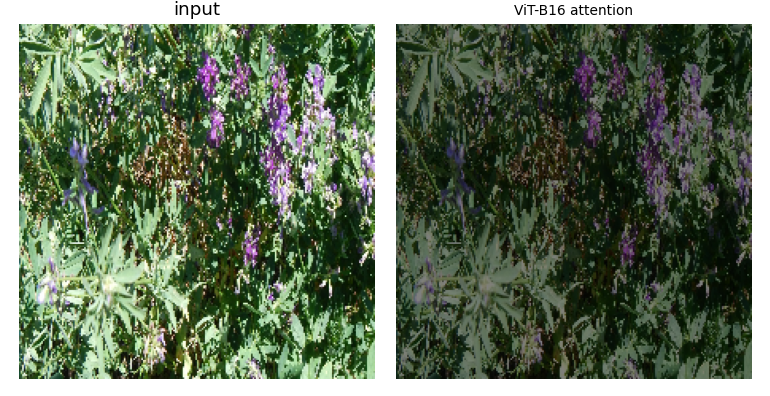

**Figure 6.1(d) — ViT-B/16 | attention-rollout.** The map is near-uniform and uninformative. For transformers without spatial conv maps, Grad-CAM-style rollout is not a reliable explanation tool on this task; SHAP/LIME are preferred (§6.1.1 continued below).

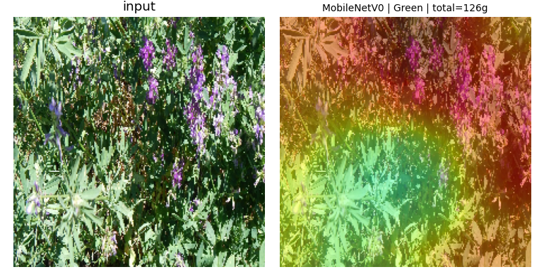

**Figure 6.1(e) — MobileNet (V1) | Green.** Despite being the weakest overall model (weighted R² = 0.6443), MobileNet’s Green Grad-CAM still concentrates on plant regions rather than bare soil or frame borders. This is important: under-fitting hurts *accuracy*, but the model’s localisation cue for Green remains biologically plausible — it is not “cheating” on background artefacts.

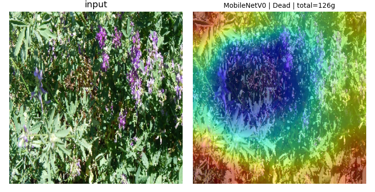

**Figure 6.1(f) — MobileNet (V1) | Dead.** As with EfficientNet-B0, Dead attention is scattered and drifts onto soil. The dead–soil failure mode is therefore shared by both the weakest and the efficiency-optimal CNN, reinforcing that it is a **data/appearance limit**, not an EfficientNet-specific artefact.

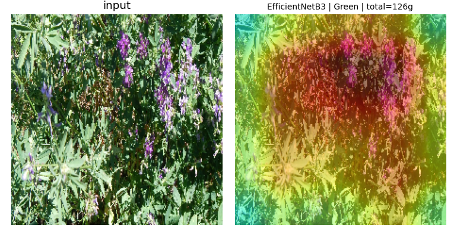

**Figure 6.1(g) — EfficientNet-B3 | Green.** Despite higher capacity than B0, B3’s Green map still lands on foliage rather than soil. Under-performance relative to B0 (Chapter 5) is therefore not explained by a qualitatively different Green focus — it aligns with the overfitting / iso-resolution story (largest train–val gap), not with background cheating.

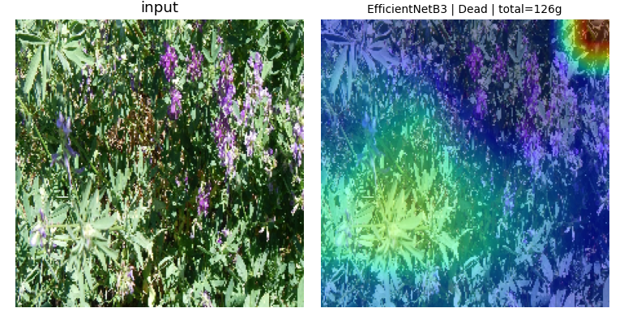

**Figure 6.1(h) — EfficientNet-B3 | Dead.** Dead attention is again diffuse and soil-contaminated. Together with Figures 6.1(c) and 6.1(f), this shows the dead–soil ceiling across the EfficientNet family and MobileNet alike — capacity scaling does not resolve spectral overlap.

**Figure 6.2 — Model-agnostic explanations (Green target).**

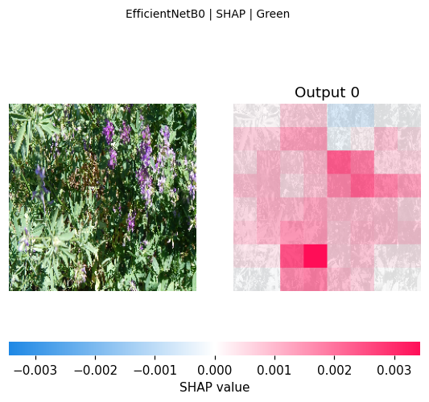

**Figure 6.2(a) — EfficientNet-B0 | SHAP (Green).** Positive (red) attributions concentrate on the plant canopy rather than soil or frame borders.

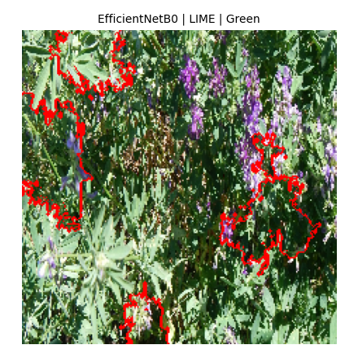

**Figure 6.2(b) — EfficientNet-B0 | LIME (Green).** Superpixels that raise the Green prediction track foliage regions.

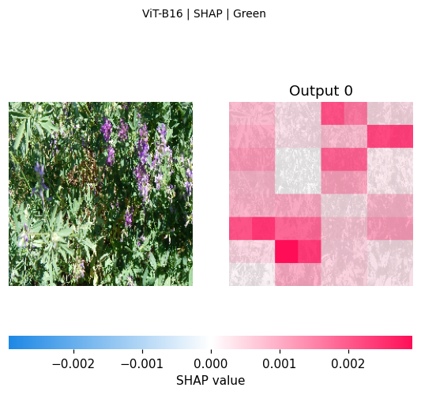

**Figure 6.2(c) — ViT-B/16 | SHAP (Green).** Positive importance is distributed across the canopy rather than locked onto a few blades — consistent with whole-image token mixing.

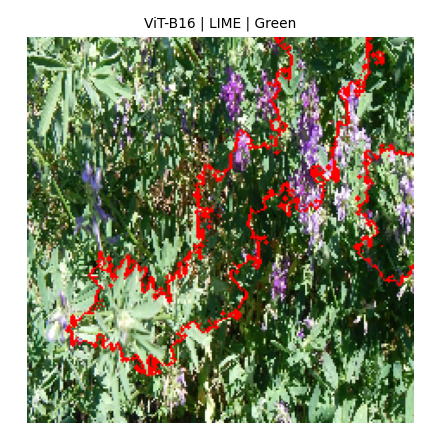

**Figure 6.2(d) — ViT-B/16 | LIME (Green).** Informative superpixels are spread over foliage, reinforcing that ViT’s Green reasoning is canopy-wide even when its attention-rollout map is unreadable.

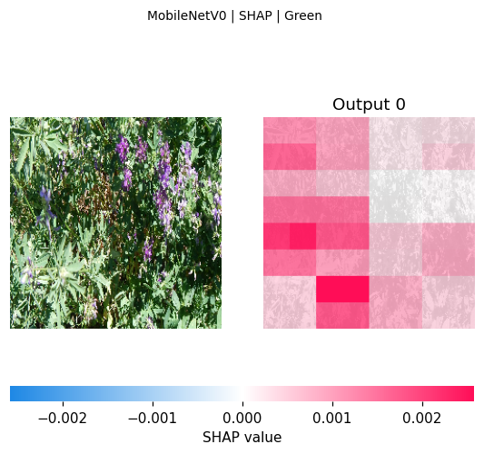

**Figure 6.2(e) — MobileNet (V1) | SHAP (Green).** Positive attributions remain plant-centred, consistent with the Grad-CAM pattern in Figure 6.1(e). MobileNet’s lower score is therefore better read as limited capacity than as spurious background reliance.

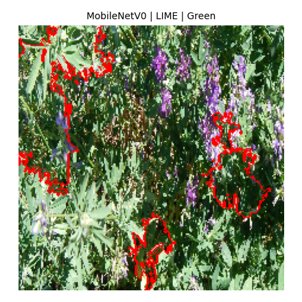

**Figure 6.2(f) — MobileNet (V1) | LIME (Green).** Foliage-aligned superpixels confirm the same plant-focused story under a second model-agnostic method.

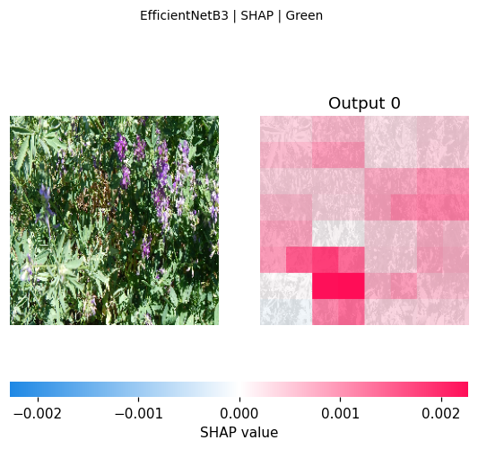

**Figure 6.2(g) — EfficientNet-B3 | SHAP (Green).** Positive attributions remain plant-centred, similar to B0. Extra parameters do not produce a visibly “better” Green explanation — consistent with B3’s failure to beat B0 on weighted R².

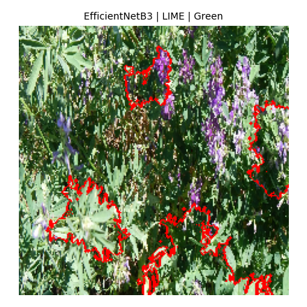

**Figure 6.2(h) — EfficientNet-B3 | LIME (Green).** Superpixels track foliage; the map does not reveal a distinct clover-specialist mechanism despite B3’s narrow Clover R² edge in Chapter 5.

---

### 6.1.2 Cross-Architecture Attention: Foliage vs. Soil

Reading Figures 6.1–6.2 together yields a clear cross-architecture pattern:

| Model | Target | Focal pattern | Consistency with accuracy |
|---|---|---|---|
| DenseNet-121 | Green | Tight foliage focus | Best Green / GDM |
| EfficientNet-B0 | Green | Plant-positive SHAP/LIME | Strong overall CNN; Pareto default |
| EfficientNet-B0 | Dead | Scattered; drifts to soil | Weak Dead R² for all CNNs |
| EfficientNet-B3 | Green | Plant-focused Grad-CAM / SHAP / LIME | Lower than B0 despite more params (overfit) |
| EfficientNet-B3 | Dead | Scattered; drifts to soil | Same dead–soil ceiling; capacity does not help |
| MobileNet (V1) | Green | Plant-focused Grad-CAM / SHAP / LIME | Lowest overall R², but plausible Green focus |
| MobileNet (V1) | Dead | Scattered; drifts to soil | Same dead–soil ceiling as other CNNs |
| ViT-B/16 | Green | Distributed canopy (SHAP/LIME) | Strong Total / Dead / Weighted |
| ViT-B/16 | Attention-rollout | Near-uniform | Not usable as explanation |

**Positive finding.** When models succeed (Green), saliency lands on plants.  
**Negative-but-useful finding.** When models fail (Dead), saliency lands on soil — the explanation *matches* the error mode rather than hiding it.  
**Method finding.** Do not rely on ViT attention-rollout alone for this task; use model-agnostic SHAP/LIME.

---

### 6.1.3 Quantitative Faithfulness and the Null Result

To move beyond single-image inspection, we measured the fraction of Grad-CAM attention mass falling on vegetation (Excess-Green > 0) across all 72 test images for the four CNNs.

**Table 6.1 — Grad-CAM attention on vegetation (% of attention mass, all test images).**

| Model | Green | Dead | Clover | Overall | vs. baseline |
|---|---|---|---|---|---|
| MobileNet (V1) | 89.8 | 90.0 | 89.6 | 89.8 | −0.4 |
| EfficientNet-B0 | 90.5 | 90.4 | 90.0 | 90.3 | +0.1 |
| EfficientNet-B3 | 90.6 | 90.2 | 90.2 | 90.4 | +0.2 |
| DenseNet-121 | 89.9 | 90.2 | 90.7 | 90.3 | +0.1 |

All models place ≈ 90% of attention on vegetation — but **vegetation already covers ≈ 90% of these dense-canopy quadrats**, so the score equals chance level (baseline ≈ 0). The metric therefore **cannot discriminate** selective plant focus from high vegetation coverage, and attention is near-identical across Green/Dead/Clover (no target specialisation at this resolution).

We report this null result transparently rather than omitting it. Quantitative *coverage* is the wrong faithfulness metric for dense-canopy imagery. Interpretability in this thesis therefore rests on the qualitative maps (Figures 6.1–6.2). Stronger **deletion/insertion faithfulness curves** (which are not saturated by high vegetation density) are left as future work (Chapter 7).

---

## 6.2 Architectural Diagnostics

### 6.2.1 Mechanistic Hypotheses: Locality vs. Global Attention

> **Read this subsection as informed speculation, not proof.** The mechanisms below are standard descriptions of how convolution and self-attention operate. They articulate *why* the measured ranking is architecturally *plausible*. They are **not evidence** that these mechanisms caused our specific results. With 357 images and overlapping confidence intervals, we cannot claim causal attribution. Verifiable claims live in Chapter 5 tables and in the XAI audit above.

**CNN locality (textures).** Convolution computes each feature from a local neighbourhood. The effective receptive field expands only gradually with depth. Pasture swards are often non-contiguous: clover leaflets and dead thatch patches are dispersed across the 70 cm × 30 cm quadrat. CNNs may therefore struggle to aggregate distant botanical fragments without aggressive pooling that blurs fine structure.

**ViT global attention (tokens).** ViT-B/16 tokenises the image into 196 patches (16×16) and computes pairwise attention among all tokens from layer 1, establishing a global receptive field immediately. This *may* help when mass is spatially scattered (Total, Dead) — consistent with ViT’s lead on those targets — but remains a hypothesis.

**Dynamic soil attenuation (hypothesis only).** Attention weights are input-conditioned, so soil tokens *could* in principle be down-weighted. Our quantitative coverage metric (§6.1.3) did **not** detect selective soil suppression on this canopy-dominated dataset; we therefore present soil attenuation as a mechanism hypothesis, not a demonstrated effect.

**Dead-matter disambiguation.** Senescent thatch shares brown reflectance with dry soil. ViT retains patch resolution without spatial pooling and attains the highest Dead R² (0.3315 vs CNN 0.225–0.257). We report the gain as an observation; resolution preservation is a plausible but unproven explanation.

---

### 6.2.2 Per-Backbone Characterization

**Table 6.2 — Best model per evaluation axis (point estimates; CIs overlap).**

| Evaluation axis | Winner | Evidence |
|---|---|---|
| Overall accuracy (weighted R²) | **ViT-B/16** | 0.7455 |
| Statistical stability (lowest σ) | **ViT-B/16** | σ = 0.087 |
| Total biomass | **ViT-B/16** | R² = 0.6524; RMSE = 14.23 g |
| Dead matter (hardest) | **ViT-B/16** | R² = 0.3315 |
| Green grass | **DenseNet-121** | R² = 0.7288 |
| GDM (Green + Clover) | **DenseNet-121** | R² = 0.7049 |
| Clover | **EfficientNet-B3** | R² = 0.5709 (near-tie with ViT) |
| Efficiency (accuracy / FLOP) | **EfficientNet-B0** | 0.7113 at 0.39 GFLOPs |
| Smallest parameter footprint | MobileNet (V1) | 4.2M parameters |

**ViT-B/16.** Strongest and most stable overall; leads Total and Dead; smallest train–val gap (Chapter 5). Best when server compute is available and aggregate / senescent targets matter.

**DenseNet-121.** Best Green and GDM extractor; largest fine-tuning gain (+0.040); Grad-CAM tightly on foliage. Weakest on Clover (0.3537) — dense feature reuse helps contiguous green texture more than sparse legumes.

**EfficientNet-B0.** Efficiency champion on the Pareto frontier; main-stage checkpoint preferred. The practical default when deployment target is unknown (§6.3).

**EfficientNet-B3.** Higher capacity than B0 but lower accuracy and largest overfit gap under iso-resolution 224² — clear evidence that bigger ≠ better here. Narrow clover edge does not compensate for weaker Total/GDM.

**MobileNet (V1).** Smallest footprint but lowest accuracy and highest Total RMSE (17.07 g). Niche is model-size constraints, not raw speed — EfficientNet-B0 is both more accurate and lower-FLOP.

**No single model wins everything.** Architecture choice should follow the operational priority (overall accuracy, green fidelity, or edge compute).

---

### 6.2.3 The Dead-Matter Bottleneck

Every architecture plateaus at Dead R² ≤ 0.33. Three linked reasons explain the ceiling:

1. **Spectral overlap.** Brown senescent thatch and dry bare soil share similar RGB reflectance; colour alone is an unreliable cue.
2. **Label–appearance mismatch.** Laboratory dry-weight includes mass that may be visually ambiguous in a top-down photo.
3. **Saliency confirmation.** Dead Grad-CAM maps scatter onto soil (Figure 6.1(c)), so the model’s “reasoning” tracks the ambiguity rather than resolving it.

ViT’s relative Dead gain is real but still leaves absolute performance in a weak band. Breaking this ceiling likely requires cues beyond RGB — texture/edge channels, NIR/red-edge, or height — discussed as future work in Chapter 7. Until then, Dead predictions should be treated with lower operational trust than Green or Total.

---

## 6.3 Efficiency and Deployment

### 6.3.1 Accuracy–Compute Pareto Frontier

**Figure 6.3** plots weighted R² against GFLOPs. Two models sit on the Pareto frontier:

- **EfficientNet-B0** — 0.7113 at 0.39 GFLOPs (accuracy-per-FLOP optimum).
- **ViT-B/16** — 0.7455 at 17.6 GFLOPs (~45× more compute for a +0.034 R² gain).

EfficientNet-B3 and DenseNet are dominated (more compute for lower or equal accuracy). MobileNet is dominated on FLOPs but retains the smallest parameter count.

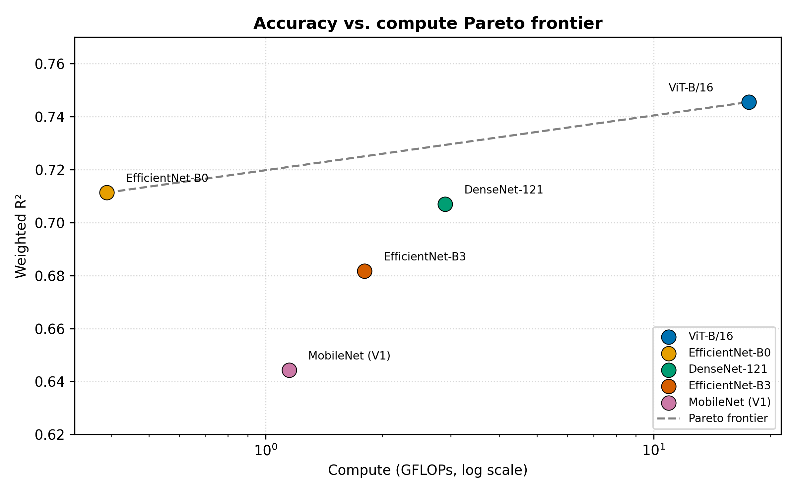

**Figure 6.3.** Accuracy–compute Pareto frontier. EfficientNet-B0 and ViT-B/16 form the frontier; the other three models are dominated. We report FLOPs rather than wall-clock latency, which depends on the target device and should be measured on-device.

---

### 6.3.2 Three-Tier Deployment Guide and Recommended Default

| Tier | Setting | Recommended model | Why |
|---|---|---|---|
| **Tier 1 — Cloud / GPU** | Server available; max accuracy | **ViT-B/16** | Highest R² and stability; best Total/Dead |
| **Tier 2 — Edge** | On-vehicle / embedded | **EfficientNet-B0** | Pareto-optimal accuracy per FLOP |
| **Tier 3 — Mobile size** | Hard model-size cap | **MobileNet (V1)** | Fewest parameters (4.2M); accept lower accuracy |

**Recommended default: EfficientNet-B0.**

If a practitioner must pick *one* model without knowing the deployment target, choose **EfficientNet-B0**. It sits on the Pareto frontier at the lowest FLOPs of any model (0.39 GFLOPs), its 0.7113 weighted R² is within 0.034 of ViT and statistically indistinguishable on this dataset (overlapping CIs), and it runs where ViT may not.

**Escalate to ViT-B/16** only when (a) server/GPU compute is guaranteed and (b) the marginal gain on Total and Dead is operationally worth ≈45× the compute (e.g. regional feed budgeting or UAV ground-truthing).

**Drop to MobileNet** only under a hard storage/memory cap — not for inference speed, where EfficientNet-B0 is superior.

**Operational role of image-only biomass.** Even the best Total RMSE (~14 g ≈ 31% of mean Total) suits **coarse paddock ranking and high/low screening**, not precise per-quadrat feed budgeting. Destructive sampling remains the calibration reference; camera-based models are a low-cost first pass.

---

## 6.4 Chapter Summary

1. **XAI (qualitative):** models attend to foliage when correct and drift to soil when Dead fails; ViT needs SHAP/LIME, not attention-rollout.
2. **XAI (quantitative):** attention-coverage ≈ 90% for all CNNs equals chance on dense canopies — an honest null result.
3. **Architecture:** ViT leads aggregates/hard targets; DenseNet leads green texture; EfficientNet-B0 leads efficiency — no universal winner.
4. **Deployment:** default **EfficientNet-B0**; escalate to **ViT-B/16** when accuracy is paramount and compute is free.

---

### Image / table map (Chapter 6)

| Label | File | Folder |
|---|---|---|
| Fig. 6.1(a–h) | Grad-CAM / attention for DenseNet, EffB0, ViT, MobileNet, **EffB3** | `thesis/figures/discussion/` |
| Fig. 6.2(a–h) | SHAP / LIME for EffB0, ViT, MobileNet, **EffB3** | `thesis/figures/discussion/` |
| Fig. 6.3 | `Fig7_pareto.png` | `thesis/figures/discussion/` |
| Table 6.1 | XAI attention-on-vegetation | — |
| Table 6.2 | Best model per axis | — |
