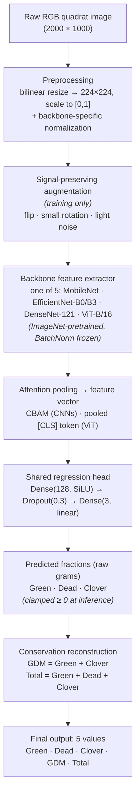
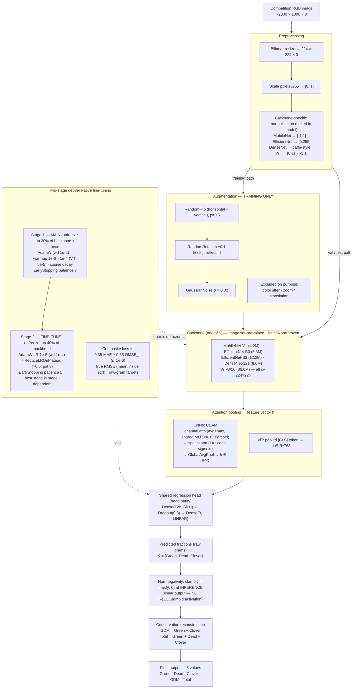

# Pipeline — Mermaid Diagrams

## 1. High-level overview (Fig. 4.1)

---

## 2. Detailed pipeline (preprocessing → training → output)

> **Notes**
> - Unfreezing is **depth-relative** (top 30% then 40% *of each backbone's layers*), so the actual layer
>   count differs per model — that is intentional (fair across different depths).
> - **Augmentation runs only during training**; validation/test images skip it.
> - **Non-negativity** is enforced only at inference by clamping (`max(ŷ, 0)`); the output layer itself is
>   **linear** — there is no ReLU/Sigmoid on the outputs.
> - GDM/Total are **reconstructed** from the 3 predicted fractions, never regressed directly.
