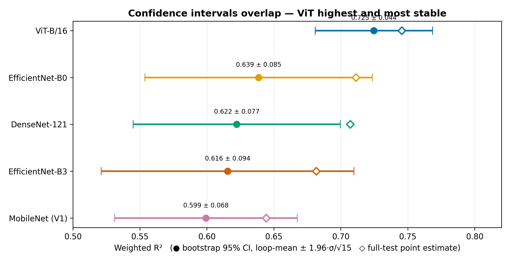
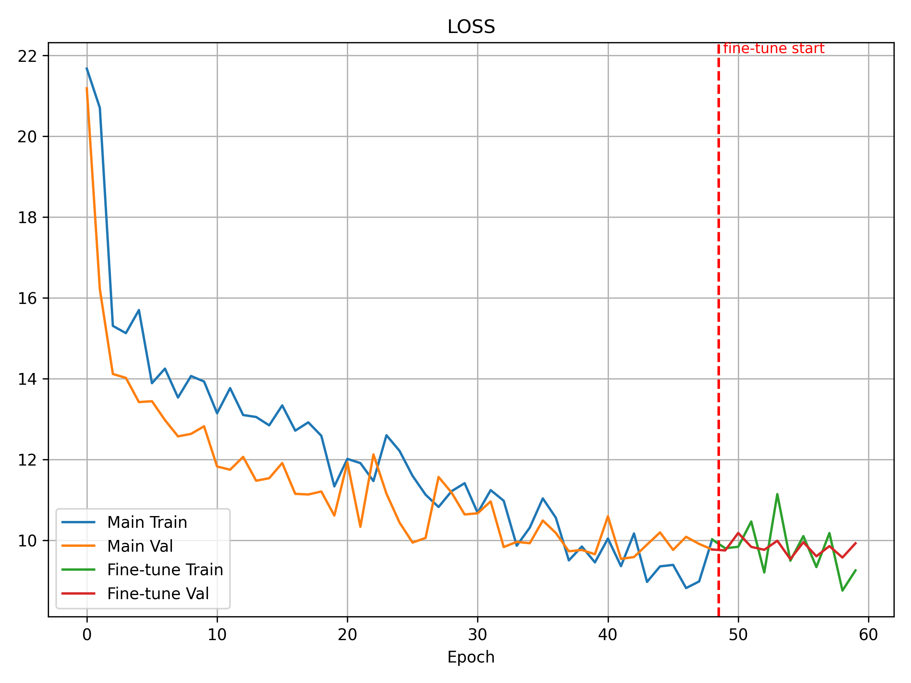
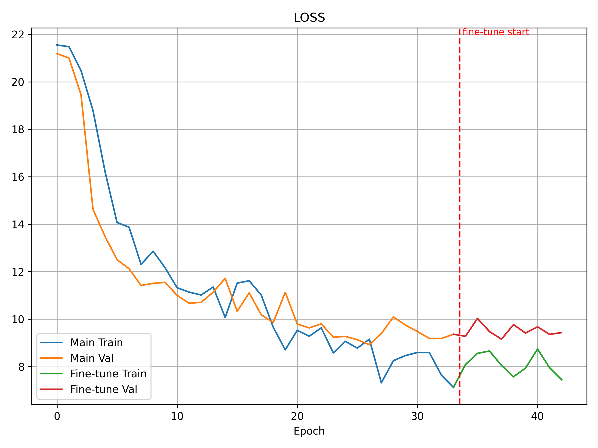
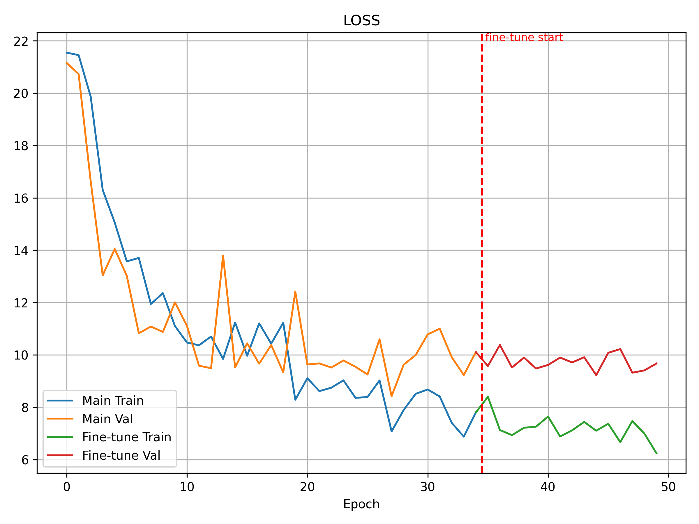
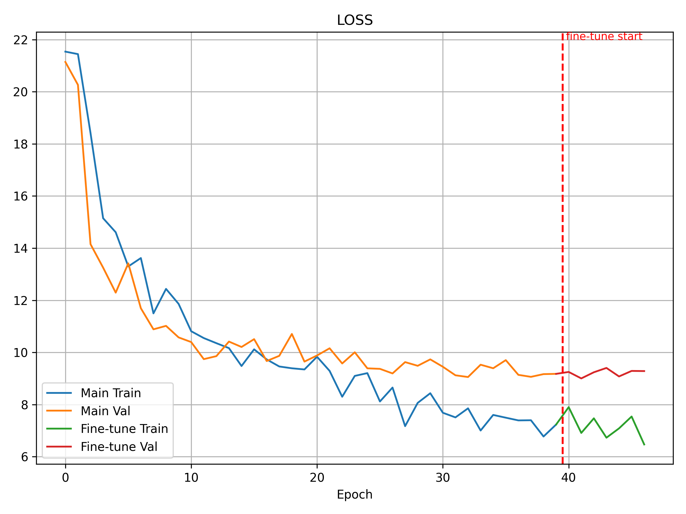
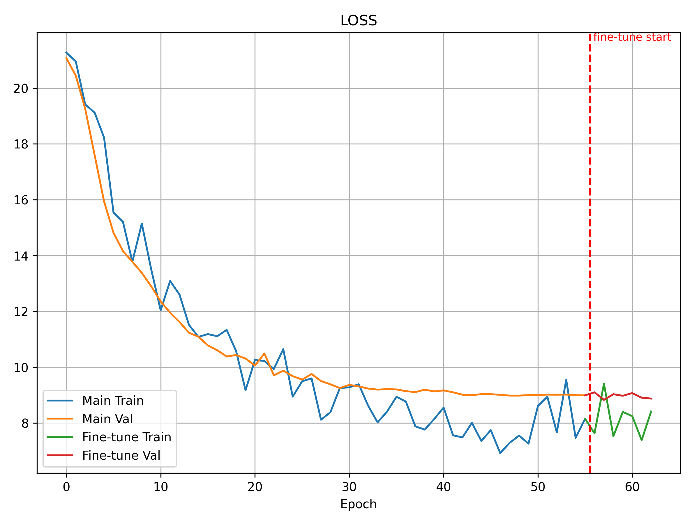
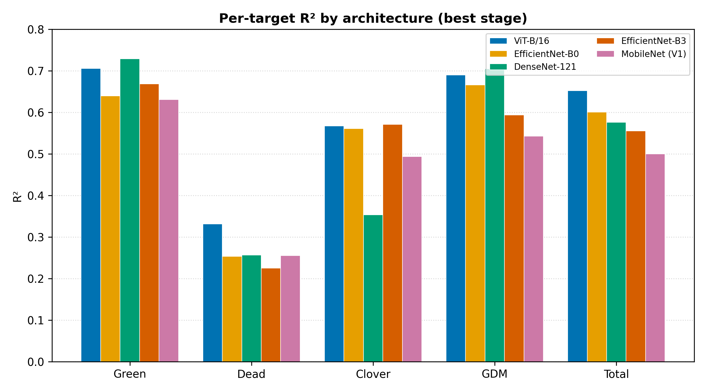

# Chapter 5 — Results and Analysis

This chapter reports the empirical findings of the controlled architectural benchmark. All five backbones were trained and evaluated under the identical pipeline described in Chapter 4 (raw-gram targets, composite loss with α = 0.35, depth-relative two-stage fine-tuning, trimmed augmentation, seed 42). Performance is measured with the competition global weighted R², supplemented by per-target R², RMSE, and MAE. Uncertainty is quantified with a 15-loop bootstrap on the shared 72-image held-out test set. Ablations on EfficientNet-B0 and ViT-B/16 isolate the contribution of each major design choice.

> **Reading note.** Throughout this chapter, “best” means the highest *point estimate* on the stated metric. As shown in §5.1.1, all model confidence intervals overlap, so rankings are treated as *consistently preferable* choices, not as statistically separable winners.

---

## 5.1 Architectural Benchmark and Model Selection

### 5.1.1 Leaderboard and Statistical Overlap

Table 5.1 reports the cross-architecture weighted-R² benchmark, including both training stages, parameter counts, FLOPs, and 95% confidence intervals. The mean-predictor baseline (always output the training-set mean) scores weighted-R² = 0 by construction; all five backbones clear this floor by a wide margin (+0.64 to +0.75), confirming that they learn genuine visual signal rather than merely exploiting the label distribution.

**Table 5.1 — Weighted-R² benchmark (raw targets; GDM = Green + Clover).**

| Model | Params | GFLOPs | main R² | ft R² | Best R² | Best stage | 95% CI | σ |
|---|---|---|---|---|---|---|---|---|
| **ViT-B/16** | 86.6M | 17.6 | 0.7398 | 0.7455 | **0.7455** | ft | [0.681, 0.769] | **0.087** |
| EfficientNet-B0 | 5.3M | 0.39 | 0.7113 | 0.7076 | **0.7113** | main | [0.554, 0.724] | 0.168 |
| DenseNet-121 | 8.0M | 2.90 | 0.6675 | 0.7070 | **0.7070** | ft | [0.545, 0.700] | 0.153 |
| EfficientNet-B3 | 12.2M | 1.80 | 0.6817 | 0.6726 | **0.6817** | main | [0.521, 0.710] | 0.186 |
| MobileNet (V1) | 4.2M | 0.57 | 0.6211 | 0.6443 | **0.6443** | ft | [0.531, 0.668] | 0.135 |
| *Mean-predictor (baseline)* | — | — | — | — | *0.000* | — | — | — |

**Notes.** Best R² is the full-test point estimate. The 95% CI is the bootstrap loop-mean ± 1.96·σ/√15 (Fix A). Because 10-image subsamples slightly under-estimate the aggregate R², each CI is centered a little below its Best-R² point estimate.

**Key observations:**

1. **ViT-B/16 leads and is the most stable.** It attains the highest point estimate (0.7455) and the lowest variance (σ = 0.087; tightest margin ±0.044).
2. **All 95% confidence intervals overlap.** On this 357-image dataset, no pairwise difference is statistically significant. Rankings must therefore be interpreted carefully (see §5.1.2 for paired-loop evidence).
3. **Fine-tuning is backbone-dependent.** It helps ViT (+0.006), DenseNet (+0.040), and MobileNet (+0.023), but slightly hurts EfficientNet-B0 (−0.004) and B3 (−0.009).
4. **Bigger is not better.** EfficientNet-B0 (0.7113) outperforms the roughly 2× larger EfficientNet-B3 (0.6817).

**Figure 5.1** visualises the same leaderboard with bootstrap intervals. ViT sits highest with the tightest band; every model’s interval still overlaps the others.

**Figure 5.1.** Weighted-R² point estimates with 15-loop bootstrap 95% confidence intervals. ViT-B/16 is highest and most stable (lowest σ); all intervals overlap, so no pairwise difference is statistically significant on the 72-image test set.

---

### 5.1.2 Paired-Loop Significance

Although the confidence intervals overlap, a *paired* per-loop comparison—scoring every model on the **same** 15 bootstrap draws—shows that the ordering is directionally consistent:

| Comparison | Loops won by ViT-B/16 | Median Δ (ViT − rival) |
|---|---|---|
| vs EfficientNet-B0 | **10 / 15** | +0.035 |
| vs DenseNet-121 | **10 / 15** | — |
| vs EfficientNet-B3 | **9 / 15** | — |
| vs MobileNet (V1) | **13 / 15** | — |

Mean per-loop Δ versus EfficientNet-B0 is +0.086. We present this as **suggestive evidence of a stable ordering**, not as proof of statistical significance. On a small test set, consistency across shared draws is the honest middle ground between a single-number leaderboard and an unsupported claim of significance.

---

### 5.1.3 Training Dynamics and Overfitting

The leaderboard in Table 5.1 reports *final* accuracy. The training curves explain *how* each backbone reached that score—whether it under-fit, over-fit, or generalised cleanly—and why Stage-2 fine-tuning helped some models but not others.

**How to read Figure 5.2.** Each panel plots the composite loss against epoch for one backbone. Blue and orange are main-stage train and validation loss; green and red are fine-tune train and validation loss; the red dashed vertical line marks the start of Stage 2. Three patterns matter:

1. **Absolute validation level** — a persistently high orange/red curve means the model never fitted the task well (under-fitting).
2. **Train–validation gap** — a large separation between train and validation means the model memorised training examples (overfitting).
3. **Stage-2 behaviour** — if fine-tuning lowers validation loss, Stage 2 was useful; if validation rises or weighted R² falls, the model had already peaked in Stage 1.

These dynamics are interpreted strictly as observed tendencies that support the Table 5.1 numbers; they are not causal proofs of architectural superiority.

**Figure 5.2(a) — MobileNet (V1).** MobileNet is the smallest backbone (4.2M parameters) and records the lowest weighted R² in Table 5.1 (0.6443). Its curves stay comparatively high through both stages: the network lacks capacity to capture dense, multi-layer sward structure from 224×224 imagery alone. Stage-2 fine-tuning still helps—weighted R² rises from 0.6211 to 0.6443 (+0.023)—showing that limited-capacity models benefit most from direct backbone adaptation. In practical terms, MobileNet under-fits rather than overfits: the failure mode is insufficient representation power, not memorisation.

**Figure 5.2(b) — EfficientNet-B0.** EfficientNet-B0 is the efficiency champion (0.7113 at 0.39 GFLOPs). Its curves converge cleanly, and the **main stage already reaches the best score**. Stage 2 slightly *reduces* weighted R² (0.7113 → 0.7076, Δ = −0.004). This indicates that compound-scaled inverted bottlenecks reach an optimal representation early on this small dataset; further unfreezing risks mild representational drift rather than additional gain. For deployment, the practical takeaway is to keep EfficientNet-B0 at its main-stage checkpoint.

**Figure 5.2(c) — EfficientNet-B3.** Despite roughly 2.3× the capacity of B0 (12.2M vs 5.3M parameters), B3 underperforms (0.6817 vs 0.7113) and shows the **largest train–validation gap** of all five architectures. Two linked explanations are consistent with the evidence. First, B3 was designed for a native 300×300 input; at the shared 224×224 resolution used for fair comparison, its wider and deeper layers lack the high-frequency pixel detail they were scaled to exploit. Second, the extra parameters then overfit the 357-image training set rather than learning richer botanical features—directly visible as the wide train–val separation in Figure 5.2(c). Stage 2 again hurts slightly (0.6817 → 0.6726). This is the clearest illustration in the study that **bigger ≠ better** under iso-resolution constraints.

**Figure 5.2(d) — DenseNet-121.** DenseNet shows the opposite Stage-2 story: fine-tuning produces the **largest absolute gain** of any model (+0.040; 0.6675 → 0.7070). The main-stage curves indicate under-fitting relative to the model’s eventual capacity; once a larger fraction of densely connected layers is unfrozen, both train and validation loss drop. This matches DenseNet’s later strength on Green and GDM (Table 5.2): dense feature reuse needs adequate backbone adaptation before local green texture is fully exploited. Unlike EfficientNet-B3, DenseNet’s gap stays moderate—capacity is used productively rather than for memorisation.

**Figure 5.2(e) — ViT-B/16.** ViT attains both the highest weighted R² (0.7455) and the **smallest train–validation gap**. The curves descend smoothly, and Stage 2 still adds a small improvement (0.7398 → 0.7455). The tight gap aligns with ViT’s lowest bootstrap variance (σ = 0.087 in Table 5.1): the model that generalises most cleanly during training is also the most stable under resampling. This does *not* by itself prove that global self-attention is the causal reason for the lead—only that ViT’s optimisation trajectory is consistent with genuine generalisation rather than memorisation on this split. (ViT also required the most careful schedule—deeper unfreeze and a lower learning rate—which the ablation in §5.3 confirms.)

**Synthesis across Figure 5.2.** Reading the five panels together yields a coherent picture that reinforces Table 5.1:

| Pattern | Models | Evidence in curves | Link to Table 5.1 |
|---|---|---|---|
| Under-fitting | MobileNet; DenseNet (main only) | High validation loss; large Stage-2 gain for DenseNet | Lowest / mid ranks until FT |
| Overfitting | EfficientNet-B3 | Largest train–val gap | B3 < B0 despite more params |
| Early saturation | EfficientNet-B0 (and B3) | Stage 2 hurts slightly | Best stage = main |
| Clean generalisation | ViT-B/16 | Smallest gap; smooth descent | Highest R² + lowest σ |

Fine-tuning is therefore **backbone-dependent**, not a universal recipe: apply it when the main stage under-fits (DenseNet, MobileNet, ViT); skip or keep the main checkpoint when Stage 1 has already peaked (EfficientNets). Deeper mechanistic interpretation of locality versus attention is reserved for Chapter 6; the curves here are used only to explain the observed ranking and stage choices.

---

## 5.2 Botanical Fraction Decomposition and Error

### 5.2.1 Per-Target R²

Table 5.2 decomposes accuracy by botanical fraction and aggregate. No single architecture wins every column: DenseNet-121 leads on green grass and GDM, ViT-B/16 leads on dead matter and Total (and on the overall weighted score), and EfficientNet-B3 edges clover by a narrow margin.

**Table 5.2 — Per-target R² (best stage; GDM = Green + Clover). Bold = best per column.**

| Model | Green | Dead | Clover | GDM | Total | Weighted |
|---|---|---|---|---|---|---|
| ViT-B/16 | 0.7054 | **0.3315** | 0.5675 | 0.6900 | **0.6524** | **0.7455** |
| EfficientNet-B0 | 0.6394 | 0.2534 | 0.5609 | 0.6660 | 0.6005 | 0.7113 |
| DenseNet-121 | **0.7288** | 0.2567 | 0.3537 | **0.7049** | 0.5762 | 0.7070 |
| EfficientNet-B3 | 0.6685 | 0.2253 | **0.5709** | 0.5935 | 0.5556 | 0.6817 |
| MobileNet (V1) | 0.6311 | 0.2550 | 0.4939 | 0.5425 | 0.4998 | 0.6443 |

**Reading the table:**

- **Dead matter is universally weak** (R² 0.23–0.33). Brown thatch overlaps bare soil spectrally; no architecture resolves this ambiguity well.
- **ViT’s relative gain on Dead** (0.3315 vs CNN range 0.225–0.257) is the largest per-target architectural separation in the study (~+29% to +47% relative to CNNs).
- **DenseNet’s Green/GDM lead** shows that dense local feature reuse remains highly effective for contiguous green texture.
- **Clover** is competitive among ViT, EfficientNet-B0, and EfficientNet-B3; DenseNet is markedly weaker (0.3537), consistent with difficulty isolating sparse legumes among grass.

**Figure 5.3.** Per-target R² by architecture. DenseNet-121 leads Green and GDM; ViT-B/16 leads Dead and Total; dead matter is the universal low target across all models.

---

### 5.2.2 Absolute Error in Grams (RMSE / MAE)

Scale-free R² does not communicate operational error. Table 5.3 therefore reports per-target RMSE and MAE in grams. The ordering mirrors Table 5.2: ViT attains the lowest Total and Dead error; DenseNet attains the lowest Green and GDM error.

**Table 5.3 — Per-target error in grams (best stage): RMSE / MAE. Bold = lowest RMSE per column. GDM = Green + Clover.**

| Model | Green | Dead | Clover | GDM | Total |
|---|---|---|---|---|---|
| ViT-B/16 | 11.77 / 7.28 | **9.83 / 6.43** | 8.78 / 5.02 | 12.21 / 8.05 | **14.23 / 9.65** |
| EfficientNet-B0 | 13.02 / 8.56 | 10.39 / 6.76 | 8.85 / 5.64 | 12.67 / 9.08 | 15.25 / 10.72 |
| DenseNet-121 | **11.29 / 7.48** | 10.37 / 6.97 | 10.73 / 6.05 | **11.91 / 8.14** | 15.71 / 11.08 |
| EfficientNet-B3 | 12.49 / 7.63 | 10.59 / 6.71 | **8.74 / 5.24** | 13.98 / 9.31 | 16.09 / 10.45 |
| MobileNet (V1) | 13.17 / 8.63 | 10.38 / 6.74 | 9.50 / 5.46 | 14.83 / 9.99 | 17.07 / 11.91 |

**Practical accuracy.** ViT’s Total-biomass RMSE of 14.23 g on a mean Total of 45.3 g is approximately **31%**. That level is adequate for **coarse paddock-level ranking** and relative high/low-biomass screening, but above the ~15–20% tolerance typically desired for precise per-quadrat feed budgeting. Image-only estimation is therefore best positioned, in the near term, as a low-cost screening tool that flags high- and low-biomass zones, with destructive sampling reserved for calibration.

MAE tracks RMSE closely for every model and target, indicating that no architecture is uniquely driven by a small number of extreme outliers.

---

### 5.2.3 Summary of Per-Axis Winners

For convenience, the point-estimate winners across evaluation axes are:

| Evaluation axis | Winner | Evidence |
|---|---|---|
| Overall accuracy (weighted R²) | **ViT-B/16** | 0.7455 |
| Statistical stability (lowest σ) | **ViT-B/16** | σ = 0.087 |
| Total biomass (metric weight 0.5) | **ViT-B/16** | R² = 0.6524; RMSE = 14.23 g |
| Dead matter (hardest target) | **ViT-B/16** | R² = 0.3315 |
| Green grass | **DenseNet-121** | R² = 0.7288; RMSE = 11.29 g |
| GDM (Green + Clover) | **DenseNet-121** | R² = 0.7049; RMSE = 11.91 g |
| Clover | **EfficientNet-B3** | R² = 0.5709 (near-tie with ViT) |
| Efficiency (accuracy per FLOP) | **EfficientNet-B0** | 0.7113 at 0.39 GFLOPs |
| Smallest parameter footprint | MobileNet (V1) | 4.2M parameters |

**No single model wins everything.** That is the practically useful result: architecture choice should follow the operational priority (overall accuracy, green fidelity, or edge compute), not a single leaderboard number. A fuller deployment mapping is deferred to Chapter 6.

---

## 5.3 Controlled Ablation on Representative Backbones

To isolate the contribution of each pipeline decision, we change **one factor at a time** from the final configuration. Ablations are run on two representative families—**EfficientNet-B0** (strongest CNN) and **ViT-B/16** (transformer)—rather than all five models. Cross-family agreement is stronger evidence of generality than repeating the sweep within the CNN family alone, and ablating all five would multiply training cost for little added insight.

### 5.3.1 Ablation on EfficientNet-B0

**Table 5.4 — Ablation on EfficientNet-B0.** Each row changes one factor from the final config; weighted-R² on the held-out test set.

| Configuration (one factor changed) | Weighted R² | Δ vs final | MAE (g) | RMSE (g) |
|---|---|---|---|---|
| **FINAL** (raw, α=0.35, unfreeze 0.30, BN frozen, trimmed aug) | **0.6965** | — | 7.03 | 10.95 |
| Target: **log1p** (vs raw) | 0.2769 | **−0.4196** | 7.70 | 14.17 |
| Loss: **α = 0.65** (MAE-heavy) | 0.6857 | −0.0108 | 6.73 | 10.77 |
| Loss: **α = 0.50** | 0.6777 | −0.0189 | 7.06 | 11.04 |
| Unfreeze: **frozen backbone** (head only) | 0.4394 | −0.2572 | 9.17 | 14.46 |
| BatchNorm: **trainable** (vs frozen) | 0.3783 | −0.3182 | 7.95 | 13.97 |
| Augmentation: **full** (color jitter + zoom) | **−0.1675** | **−0.8641** | 11.14 | 17.91 |

**Ranked impact (EfficientNet-B0):**

1. **Augmentation is the most critical choice.** Restoring full colour-jitter + zoom is catastrophic (R² collapses to −0.17, Δ = −0.86): colour jitter destroys the greenness cue, and zoom corrupts fixed-label canopy density.
2. **Raw targets matter next.** log1p conditioning drops R² by 0.42 (to 0.28), confirming the raw-gram rationale of Chapter 3.
3. **BatchNorm must stay frozen.** Trainable BN drops R² by 0.32 (to 0.38).
4. **Backbone adaptation is necessary.** Freezing the whole backbone drops R² by 0.26 (to 0.44).
5. **Loss balance α is the least sensitive knob.** α = 0.35 marginally beats α = 0.50 (−0.019) and α = 0.65 (−0.011).

Summary ranking: **augmentation ≫ target-scale > BatchNorm > unfreezing > loss-α.**

*(Note: the single-stage ablation baseline of 0.6965 is consistent with—but slightly below—the 0.7113 of the full two-stage EfficientNet-B0 reported in Table 5.1.)*

---

### 5.3.2 Ablation on ViT-B/16

Because ViT has neither BatchNorm nor a CBAM head, the BN ablation is replaced by two transformer-relevant factors: peak learning rate and the over-conservative unfreeze fraction that originally under-trained the model.

**Table 5.5 — Ablation on ViT-B/16.** Same one-factor protocol; single-stage weighted-R².

| Configuration (one factor changed) | Weighted R² | Δ vs final | MAE (g) | RMSE (g) |
|---|---|---|---|---|
| **FINAL** (raw, α=0.35, unfreeze 0.30, LR 5e-5, trimmed aug) | **0.7398** | — | 6.39 | 10.27 |
| Target: **log1p** (vs raw) | 0.2313 | **−0.5084** | 8.18 | 14.41 |
| Loss: **α = 0.65** (MAE-heavy) | 0.6981 | −0.0417 | 6.66 | 10.76 |
| Loss: **α = 0.50** | 0.7277 | −0.0120 | 6.47 | 10.46 |
| Unfreeze: **frozen backbone** (head only) | 0.2765 | −0.4633 | 8.81 | 14.91 |
| Unfreeze: **0.15** (over-conservative, original) | 0.2886 | −0.4512 | 8.78 | 14.83 |
| LR: **1e-4** (vs 5e-5, too hot for ViT) | 0.7127 | −0.0271 | 6.20 | 10.20 |
| Augmentation: **full** (colour jitter + zoom) | **0.0917** | **−0.6481** | 10.46 | 16.65 |

**Transformer-specific confirmations:**

- The over-conservative **0.15 unfreeze collapses ViT to 0.29**, justifying the deeper 0.30/0.40 schedule used in the final pipeline.
- The hotter **1e-4 learning rate costs ~0.03**, justifying the gentler 5e-5 schedule.

---

### 5.3.3 Cross-Model Agreement

Both backbones agree on the same importance ranking:

> **augmentation and raw targets are the most critical choices**  
> (removing either costs 0.42–0.86 R² on EfficientNet-B0 and 0.51–0.65 on ViT),  
> followed by backbone unfreezing,  
> with the loss-α knob least sensitive.

That the same design decisions transfer from a CNN to a transformer strengthens their generality: they are properties of the *task and pipeline*, not artefacts of a single inductive bias.

---

## 5.4 Chapter Summary

1. **ViT-B/16** attains the best overall weighted R² (0.7455) and the lowest variance, and leads on Total and Dead; **EfficientNet-B0** is the efficiency-optimal CNN (0.7113 at 0.39 GFLOPs); **DenseNet-121** is the best green/GDM extractor.
2. **All bootstrap CIs overlap**; paired-loop wins (ViT 9–13 of 15) support a consistent ordering without claiming significance.
3. **Dead matter** remains the universal bottleneck (R² ≤ 0.33); Total RMSE of the best model (~14 g / ~31%) suits screening, not precise feed budgeting.
4. **Ablations** show that trimmed augmentation and raw-gram targets dominate performance on both a CNN and a transformer; BatchNorm freezing and adequate unfreezing are the next most important controls.

Explainability maps, architectural diagnostics, and deployment guidance are developed in Chapter 6.

---

### Image / table numbering (Chapter 5)

Figures and tables in this chapter use **chapter-local** numbering (`Fig. 5.x`, `Table 5.x`), which matches Google Docs / IUB thesis style.

| Thesis label | File to insert | Source path |
|---|---|---|
| **Fig. 5.1** | `Fig2_ci_intervals.png` | `thesis/figures/results/` |
| **Fig. 5.2(a–e)** | `Fig3a_MobileNet_loss.png` … `Fig3e_ViT_loss.png` | `thesis/figures/results/` |
| **Fig. 5.3** | `Fig4_per_target_r2.png` | `thesis/figures/results/` |

| Thesis label | Content |
|---|---|
| **Table 5.1** | Weighted-R² leaderboard + CI |
| **Table 5.2** | Per-target R² |
| **Table 5.3** | Per-target RMSE / MAE |
| **Table 5.4** | Ablation — EfficientNet-B0 |
| **Table 5.5** | Ablation — ViT-B/16 |

*(Explainability and Pareto figures belong in Chapter 6 — Discussion, as Fig. 6.x.)*
